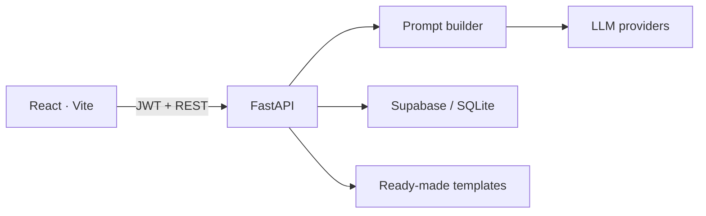

# Waypoint

**Personalized Travel Itinerary Planner**

AI-assisted trip planning for solo weekends, couples, and small groups. Pick a ready-made itinerary or generate a day-by-day plan from destination, dates, budget, and travel style.

[](frontend)
[](backend)
[](backend/database)
[](LICENSE)

Repository: [2praveen6/travel-itinerary-skill-wallet](https://github.com/2praveen6/travel-itinerary-skill-wallet)

<p align="center">
  
</p>

---

## Features

- **Ready-made trips** — curated plans for Paris, Bali, Goa, Kyoto, Barcelona, and Tokyo
- **Custom builder** — destination, dates, group size, budget, pace, dietary and mobility notes
- **AI itineraries** — Groq (with Hugging Face / OpenAI / Ollama fallback) plus a rule-based engine if no keys are set
- **Structured days** — timed stays, dining, attractions, and local transport with estimated cost
- **Save, edit, share** — dashboard, per-day refresh, public share links, Markdown / ICS export
- **Recommendations** — destinations ranked from traveler preferences

## Tech stack

| Layer | Choice |
| --- | --- |
| UI | React 18, Vite, React Router, Framer Motion, Lucide |
| API | FastAPI, Pydantic, JWT |
| Data | Supabase Postgres (production) or SQLite (local fallback) |
| AI | Groq, optional OpenAI / Hugging Face / Ollama |
| Deploy | Render (API) · Vercel (frontend) |



## Project layout

```
├── backend/                 FastAPI application
│   ├── app/                 routes, auth, AI, templates
│   ├── database/            Postgres + SQLite schema
│   └── requirements.txt
├── frontend/                Vite React app
│   └── src/pages/           Home, Explore, builder, trips
├── docs/                    Screenshots
├── render.yaml              Render blueprint
└── frontend/vercel.json     Vercel settings
```

## Quick start

**Requirements:** Python 3.11+, Node 18+, Git.

### 1. Backend

```bash
cd backend
python -m venv .venv
# Windows: .\.venv\Scripts\activate
# macOS/Linux: source .venv/bin/activate
pip install -r requirements.txt
copy .env.example .env   # or: cp .env.example .env
```

Set at least `SECRET_KEY` and `JWT_SECRET` in `backend/.env`. Then:

```bash
uvicorn app.main:app --reload --port 5000
```

API docs: http://localhost:5000/docs · health: http://localhost:5000/api/health

### 2. Frontend

```bash
cd frontend
npm install
npm run dev
```

App: http://localhost:5173  
Vite proxies `/api` to the backend, so you do not need `VITE_API_URL` locally.

Never commit `.env` files. Use the `.example` templates only.

## Configuration

| Variable | Where | Purpose |
| --- | --- | --- |
| `SECRET_KEY` / `JWT_SECRET` | backend | Sign auth tokens |
| `FRONTEND_URL` | backend | CORS + share-link origin |
| `SUPABASE_URL` | backend | Project URL (no `/rest/v1` suffix) |
| `SUPABASE_SERVICE_ROLE_KEY` | backend | Server-side data access |
| `GROQ_API_KEY` | backend | Live generated itineraries |
| `VITE_API_URL` | frontend (prod) | Render API origin, no trailing slash |

Full key list: [`backend/.env.example`](backend/.env.example).  
Supabase SQL: [`backend/database/schema.sql`](backend/database/schema.sql). If trip create reports a missing column (`PGRST204`), run [`backend/database/migrate_trips.sql`](backend/database/migrate_trips.sql).

## Documentation

- [Local setup](SETUP.md)
- [Deployment (Render + Vercel)](DEPLOYMENT.md)
- [Architecture](ARCHITECTURE.md)
- [HTTP API](API.md)

## License

MIT — see [LICENSE](LICENSE).
